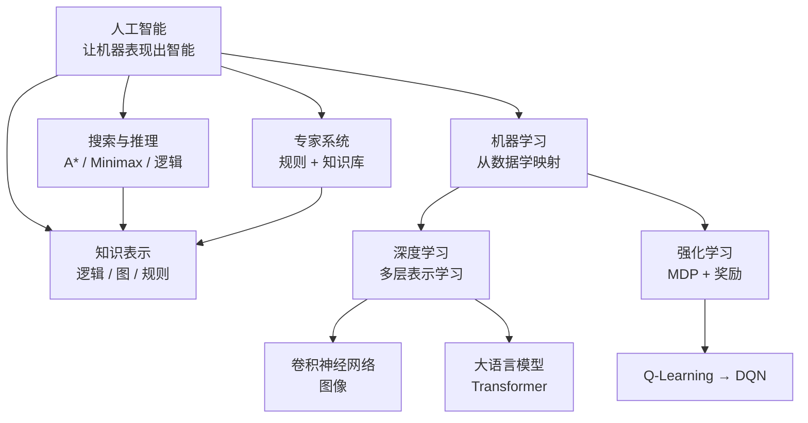

# Artificial_Intelligence

> **人类入口页 / 学科 MOC**。本页由 agent 生成，正文你可自由改写。知识内容全部在 `wiki/`，此处只做导航与进度。

**当前覆盖**：一门课（《人工智能导论》八章）+ 一门工具课（机器学习科学计算库），共 9 篇素材全部编译（9/9），产出 9 摘要 + 9 概念 + 4 实体。另有 2 页外部来源补课页（`provenance: external`，素材未展开）：[[K均值聚类]]、[[感受野与残差连接]]。

## 知识地图

## 课程主线（八章）

## 页面清单

| 页面 | 类型 | 成熟度 | 一句话 |
|---|---|---|---|
| [[人工智能]] | concept | evergreen | 学科总览：三大学派、三次浪潮、产业链 |
| [[图灵测试]] | concept | budding | 「机器会思考吗」的操作化判据 |
| [[机器学习]] | concept | evergreen | 三范式、风险与泛化、判别/生成方法 |
| [[深度学习]] | concept | budding | 自动学特征的多层表示学习 |
| [[神经网络]] | concept | budding | 神经元 + 激活 + 反向传播 |
| [[卷积神经网络]] | concept | budding | 参数共享的视觉骨干 |
| [[强化学习]] | concept | budding | 与环境交互、最大化累积奖励 |
| [[专家系统]] | concept | evergreen | 知识库 + 推理机的规则系统 |
| [[知识表示]] | concept | budding | 逻辑 / 图 / 规则三种形态 |
| [[K均值聚类]] | concept | budding | Lloyd 两步 + k-means++；无 raw 素材（external） |
| [[感受野与残差连接]] | concept | budding | RF 递推式、残差为何缓解深层优化瓶颈；external |
| [[图灵]] | entity | budding | 图灵机与图灵测试的提出者 |
| [[达特茅斯会议]] | entity | budding | 1956 年确立「人工智能」学科名 |
| [[AlphaGo]] | entity | budding | 策略/价值网络 + MCTS |
| [[人工智能导论]] | entity | budding | 八章与摘要页的映射表 |

摘要页（9）：[[2026-10-27-人工智能绪论]]、[[2026-10-27-人工智能应用]]、[[2026-10-27-搜索求解与逻辑推理]]、[[2026-10-27-机器学习]]、[[2026-10-27-深度学习与神经网络]]、[[2026-10-27-强化学习与Q-Learning]]、[[2026-10-27-博弈安全]]、[[2026-10-27-大语言模型与低空经济]]、[[2026-10-27-机器学习科学计算库]]

## 必须记住的三条主线

1. **包含链**：人工智能 ⊃ 机器学习 ⊃ 深度学习 ⊃ 大语言模型。答题时层级不能颠倒。
2. **学习范式**：监督（有标签）／无监督（找结构）／强化（靠奖励试错）。区别在**反馈的形式与时机**，不在任务名称。
3. **泛化**：经验风险（训练集）小但期望风险（真实分布）大 = 过拟合；两者都大 = 欠拟合。对策是结构风险最小化（加正则项）。

## 高频易错点

| 易错点 | 正确说法 |
|---|---|
| 图灵测试 30% 是「通过标准」 | 1950 年论文里它是**预测**（2000 年机器能让 30% 裁判误判），不是定义阈值 → [[图灵测试]] |
| AlexNet 2012 就超过人类 | AlexNet top-5 错误率 15.3%，人类约 5.1%；首个低于人类的是 2015 ResNet（3.57%） |
| 囚徒困境是不完全信息博弈 | 完全信息——收益矩阵是共同知识 |
| 判别方法与生成式 AI 是一回事 | 判别/生成指**概率建模方式**（学 P(Y\|X) 还是 P(X,Y)）；生成式 AI 指**产品形态**，不同层 |
| K-means 能自动定 k | 必须预先给定 k，且对初始化敏感 |
| 强化学习就是监督学习的一种 | 反馈是延时奖励、输入随行为变化、不满足独立同分布 |

## 素材与索引

- 原始素材全部在 `raw/Artificial_Intelligence/`（8 个 Chapter + 1 个库课讲义）
- 展开条文见 [[_Index_Wiki]]；本节只做导航

## 状态与待办

- [x] 9 篇素材已编译为 wiki（9 摘要 + 9 概念 + 4 实体）
- [x] 为 Ch1/Ch5/Ch6/Ch7/Ch8 的素材错误写了「原文错值 → 正确值 → 证据」
- [x] 用联网核实了 3 处：AlexNet/人类基线、露西年代、2024 图灵测试复现实验
- [ ] **待你决定**：是否补素材补上「专家系统架构分层 + MYCIN 等经典系统」「K-means 目标函数」「CNN 感受野/BN/残差」「反向传播完整推导」
- [x] **已裁定（2026-10-27）**：把 30% 的口径写回两篇摘要页（[[2026-10-27-人工智能绪论]]、[[2026-10-27-机器学习科学计算库]]），三页统一为「图灵原话的预测阈值，非共识判据」

## 原始素材

- [[raw/Artificial_Intelligence/Chapter_1_Introduction_to_Artificial_Intelligence]]
- [[raw/Artificial_Intelligence/Chapter_2_Applications_of_Artificial_Intelligence]]
- [[raw/Artificial_Intelligence/Chapter_3_Search_Solving_and_Logical_Reasoning]]
- [[raw/Artificial_Intelligence/Chapter_4_Machine_Learning]]
- [[raw/Artificial_Intelligence/Chapter_5_Deep_Learning_and_Neural_Networks]]
- [[raw/Artificial_Intelligence/Chapter_6_Reinforcement_Learning]]
- [[raw/Artificial_Intelligence/Chapter_7_Game_Theory_and_Security]]
- [[raw/Artificial_Intelligence/Chapter_8_Development_and_Challenges]]
- [[raw/Artificial_Intelligence/Machine_Learning (Scientific_Computing_Library)]]

## 跨学科综述

- [[概率与机器学习之间的一段路]] —— 数学侧的高斯积分/正态/边缘化 vs AI 侧的机器学习/神经网络，指出本库缺的线性代数与多元微积分

返回 [[_Index_Wiki]]。
