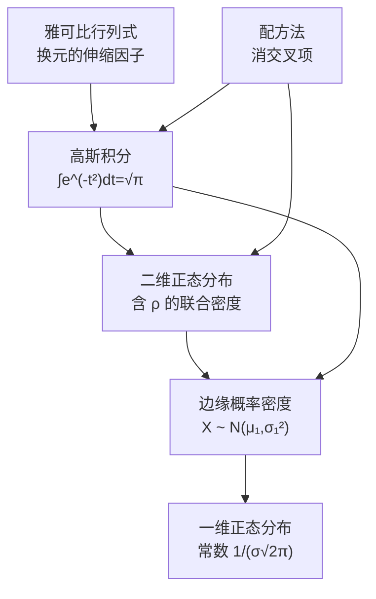

# College_Math

> **人类入口页 / 学科 MOC**。本页由 agent 生成，正文你可自由改写。知识内容全部在 `wiki/`，此处只做导航与进度。

**当前覆盖**：一条完整的推导链——标准高斯积分 → 二维正态分布 → 边缘概率密度，外加离散/连续的横向对照。素材已全部编译（3/3）。

## 知识地图

## 建议学习顺序

## 页面清单

| 页面 | 类型 | 成熟度 | 一句话 |
|---|---|---|---|
| [[高斯积分]] | concept | budding | 值为 √π 的无穷积分，正态归一化的基石 |
| [[雅可比行列式]] | concept | budding | 换元时的面积伸缩系数，极坐标下 J = r |
| [[配方法]] | concept | budding | 把含 ρ 的二次型拆成完全平方 + 余项 |
| [[二维正态分布]] | concept | budding | 五个参数，交叉项是它的标志 |
| [[边缘概率密度]] | concept | budding | 积掉另一个变量后的一维密度 |
| [[一维正态分布]] | concept | budding | 归一化常数 1/(σ√2π) 由高斯积分给出 |
| [[一维与二维正态分布]] | comparison | budding | 常数、交叉项、边缘关系的逐项对照 |
| [[离散与连续随机变量的边缘分布]] | comparison | budding | 离散求和 vs 连续积分，含最小算例 |
| [[2026-10-14-标准高斯积分]] | summary | budding | 完整推导过程 |
| [[2026-10-14-二维正态分布边缘密度]] | summary | budding | 五步推导得式 (3.1.5) |
| [[2026-10-14-离散与连续随机变量的边缘分布]] | summary | budding | 两篇讲义的推荐笔记，内嵌离散边缘定义 |

## 三个必记结论

| 结论 | 式子 |
|---|---|
| 基础高斯积分 | $\int_{-\infty}^{+\infty}e^{-t^2}dt=\sqrt{\pi}$ |
| 正态专用 | $\int_{-\infty}^{+\infty}e^{-z^2/2}dz=\sqrt{2\pi}$ |
| 边缘密度与 ρ 无关 | $f_X(x)=\frac{1}{\sqrt{2\pi}\sigma_1}e^{-(x-\mu_1)^2/2\sigma_1^2}$ |

## 三个常见坑

- 换元后忘了取 $|J|$ 的**绝对值**，只写 $J$。
- 配方时把 $+\rho^2u^2$ 补进去却没减回来，二次型就不等了。
- 以为「边缘分布能反推 $\rho$」——恰恰不能，$\rho$ 在边缘密度里消失。

## 状态与待办

- [x] 3 篇素材已编译为 wiki
- [x] 概念页与摘要页双向互链
- [x] 新建 [[一维与二维正态分布]] 对比页
- [x] 补充一维正态密度的归一化推导 → [[一维正态分布]]
- [x] 离散/连续边缘分布对比 → [[离散与连续随机变量的边缘分布]]（素材已于 2026-10-14 补齐）
- [ ] **可选**：若日后拿到推荐的两篇讲义正文（北大李东风《概率统计 B》第四章、Caltech Math 408 L21），可把「表格法例 1.4」扩成完整算例

## 原始素材

- [[raw/College_Math/标准高斯积分]]
- [[raw/College_Math/二维正态分布边缘密度]]
- [[raw/College_Math/离散_连续随机变量的边缘分布]]

## 跨学科综述

- [[概率与机器学习之间的一段路]] —— 高斯积分/正态/边缘化怎样接到机器学习，附四个接口与本库的数学缺口清单

返回 [[_Index_Wiki]]。
