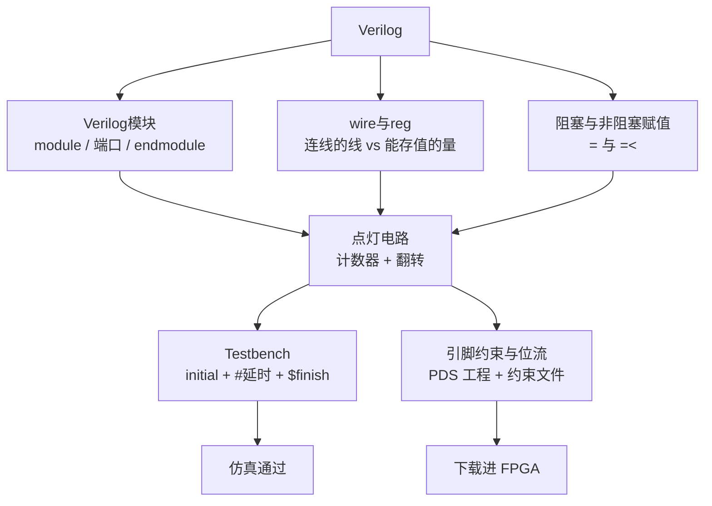
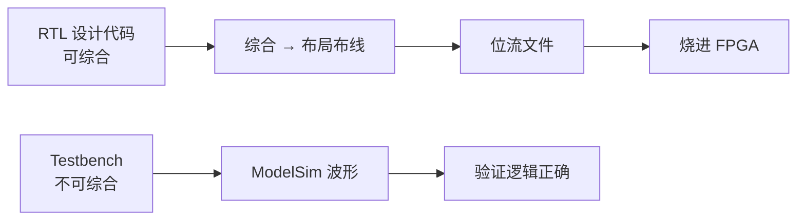

# Embedded_System

> **人类入口页 / 学科 MOC**。本页由 agent 生成，正文你可自由改写。知识内容全部在 `wiki/`，此处只做导航与进度。

**当前覆盖**：1 篇素材（FPGA 点灯入门），已编译（1/1），产出 1 摘要 + 4 概念 + 1 实体 + 1 对比。这是一条**从零到板上有反应**的最短路径，重点不在电路设计，而在 Verilog 的语法分类与工具链顺序。另有 1 页外部来源补课页：[[时序约束]]（素材只讲语法，不讲综合后时序是否收敛）。

## 知识地图

## RTL 与 Testbench 的分界

## 页面清单

| 页面 | 类型 | 成熟度 | 一句话 |
|---|---|---|---|
| [[Verilog模块]] | concept | budding | 电路的基本封装单位与端口声明 |
| [[wire与reg]] | concept | budding | 线网连信号，寄存器在 always 里存值 |
| [[阻塞与非阻塞赋值]] | concept | budding | 时序用 `<=`，组合用 `=` |
| [[引脚约束与位流]] | concept | seedling | 把端口映射到真实引脚并生成位流 |
| [[时序约束]] | concept | budding | setup/hold 不等式、slack 判读、例外路径；无 raw 素材（external） |
| [[FPGA]] | entity | seedling | 可编程逻辑器件与 PDS 工具链 |
| [[RTL设计与Testbench]] | comparison | budding | 可综合与否、语法边界、运行环境 |
| [[2026-10-27-Verilog点灯入门]] | summary | budding | 从建工程到板上有反应的完整流程 |

## 点亮一个 LED 的最小闭环

1. 写 `module` + 端口（`input clk, rst_n`；`output reg led`）
2. 写计数器：`always @(posedge clk or negedge rst_n)` 内用 `<=`
3. 到阈值翻转 `led`（`parameter CNT_MAX` 便于仿真时改小）
4. 写 Testbench：`initial` 产生时钟、`#` 延时、`$finish` 结束
5. 引脚约束：把 `clk`/`rst_n`/`led` 绑到目标板引脚
6. 综合 → 布局布线 → 生成位流 → 下载

## 高频易错点

| 易错点 | 正确说法 |
|---|---|
| 时序块里用 `=` 也行 | 一律 `<=`；用 `=` 会让多条赋值串行生效，仿真与综合不一致 |
| 组合块里用 `<=` 也行 | 一律 `=`；用 `<=` 会让输出延迟一拍 |
| 组合块分支可以不全 | 分支不全综合出**锁存器**（`latch inferred`），是隐蔽时序隐患 |
| RTL 里可以写 `#10` 延时 | 不可综合；`#` 只属于 Testbench |
| `initial` 可以给电路做初始化 | RTL 里应用复位信号，`initial` 只用于仿真 |
| Testbench 也要有端口 | 通常没有端口，它是自包含的激励发生器 |

## 状态与待办

- [x] 1 篇素材已编译为 wiki（1 摘要 + 4 概念 + 1 实体 + 1 对比）
- [ ] **待你决定**：素材只到点灯/流水灯，缺时序约束（SDC）、跨时钟域、仿真覆盖率、状态机写法——是否补素材
- [ ] [[引脚约束与位流]] 与 [[FPGA]] 目前是 `seedling`（素材给的是具体型号操作，未给通用原理），后续补素材后可升级

## 原始素材

- [[raw/Embedded_System/fpga/led_flash]]

## 跨学科综述

- [[寄存器时钟与分频]] —— 把本页的 clk/reg/always 与微机原理的寄存器、标志、位运算对上

返回 [[_Index_Wiki]]。
