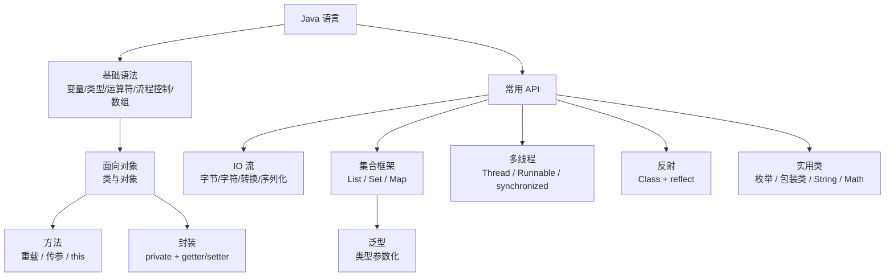
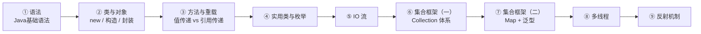

# Java

> **人类入口页 / 学科 MOC**。本页由 agent 生成，正文你可自由改写。知识内容全部在 `wiki/`，此处只做导航与进度。

**当前覆盖**：一套 Java SE 入门课的前 9 篇（基础语法 → 面向对象 → 常用 API），素材全部编译（9/9），产出 9 摘要 + 9 概念 + 1 实体。另有 3 页无 raw 素材的补课页（`provenance: external`）：[[继承与多态]]、[[异常处理]]、[[JVM内存与垃圾回收]]。**仍未覆盖注解、Lambda/Stream、Maven/Gradle、网络编程与 JDBC。**

## 知识地图

## 建议学习顺序

## 页面清单

| 页面 | 类型 | 成熟度 | 一句话 |
|---|---|---|---|
| [[面向对象]] | concept | budding | 以对象组织程序；素材只到封装 |
| [[类与对象]] | concept | budding | 模板与实例、构造方法、this |
| [[方法重载]] | concept | budding | 同名靠参数区分，返回值不参与判定 |
| [[集合框架]] | concept | budding | Collection / Map 两条主线与选型 |
| [[泛型]] | concept | budding | 把类型错误从运行期前移到编译期 |
| [[多线程]] | concept | budding | 进程内多执行路径与同步 |
| [[反射机制]] | concept | budding | 运行期观察与修改类，入口是 Class |
| [[枚举]] | concept | budding | 取值受限的具名常量 |
| [[IO流]] | concept | budding | 程序与外部数据源之间的通道 |
| [[继承与多态]] | concept | budding | 单继承限制 + 运行期按实际类型分派；无 raw 素材（external） |
| [[异常处理]] | concept | budding | 受检/非受检的判定 + try-with-resources；external |
| [[JVM内存与垃圾回收]] | concept | budding | 六块运行时数据区 + 收集器对照；external |
| [[Java]] | entity | evergreen | 语言实体页 + 9 篇素材的组织顺序 |

摘要页（9）：[[2026-10-27-Java基础语法]]、[[2026-10-27-类与对象]]、[[2026-10-27-方法与重载]]、[[2026-10-27-输入输出处理]]、[[2026-10-27-集合框架与泛型（一）]]、[[2026-10-27-集合框架与泛型（二）]]、[[2026-10-27-多线程]]、[[2026-10-27-反射机制]]、[[2026-10-27-实用类与枚举]]

## 贯穿全线的三个概念

1. **引用语义**：对象变量存的是地址，方法传参传的是地址副本——所以「方法内改对象字段」会影响外部，「重新赋值」不会。
2. **`equals` 与 `==`**：`==` 比地址（基本类型比数值），`equals` 比内容。字符串比较必须用 `equals`。
3. **类型擦除**：泛型信息只存在于编译期，运行期被擦成 `Object`——这就是不能 `new T[]`、不能用基本类型做类型参数的根因。

## 高频易错点

| 易错点 | 正确说法 |
|---|---|
| `start()` 与 `run()` 等价 | `start()` 才开新线程；直接调 `run()` 是普通方法调用 |
| Set 是「不唯一无序」 | Set **元素唯一**、无序（素材体系图那处写错了） |
| 重载看返回值类型 | 不看；只有参数列表（个数/类型/顺序）参与判定 |
| `Constructor`/`Field` 在 `java.lang` | 在 `java.lang.reflect`，只有 `Class` 在 `java.lang` |
| 字符流就是字节流 | 字符流是字节流 + 编码/解码，选错编码即乱码 |
| 反射只是「调试用」 | 框架（Spring/MyBatis）的注解扫描与依赖注入全靠它 |

## 素材与索引

- 原始素材全部在 `raw/Frontend_Backend/`（`Java_Basics` 起 9 篇）
- 展开条文与代码示例见各摘要页；总索引见 [[_Index_Wiki]]

## 状态与待办

- [x] 9 篇素材已编译为 wiki（9 摘要 + 9 概念 + 1 实体）
- [x] 5 处素材事实订正已写入页面（关系运算符表述、反射包名等）
- [x] **2026-10-27 已补三页**（无 raw 素材，按 AGENTS.md §4.3 标 `provenance: external`、状态上限 `budding`）：[[继承与多态]]、[[异常处理]]、[[JVM内存与垃圾回收]]
- [ ] **待你决定**：是否继续补「注解、Lambda/Stream、Maven/Gradle、网络编程与 JDBC」——同样无 raw 来源
- [ ] 可选：把 [[位运算]] 拆出「Java 语境」段落，避免与微机原理语境混用

## 原始素材

- [[raw/Frontend_Backend/Java_Basics]]
- [[raw/Frontend_Backend/Classes_and_Objects]]
- [[raw/Frontend_Backend/Methods_and_Method_Overloading]]
- [[raw/Frontend_Backend/Input_and_Output_Processing]]
- [[raw/Frontend_Backend/Set_Framework_and_Generics1]]
- [[raw/Frontend_Backend/Set_Framework_and_Generics2]]
- [[raw/Frontend_Backend/Multithreading]]
- [[raw/Frontend_Backend/Reflex_Mechanism]]
- [[raw/Frontend_Backend/Practical_Introduction]]

## 跨学科综述

- [[从裸机到Hive-Metastore]] —— Java 是 Hadoop/Hive/Zeppelin 全线的运行时前提，JAVA_HOME 配错是这条链最常见的开端

返回 [[_Index_Wiki]]。
