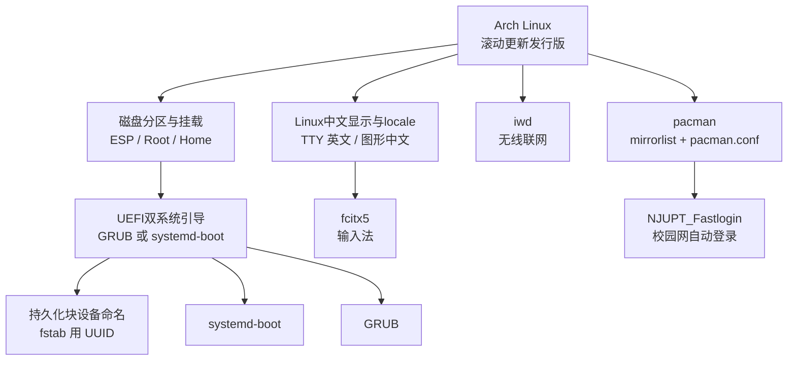
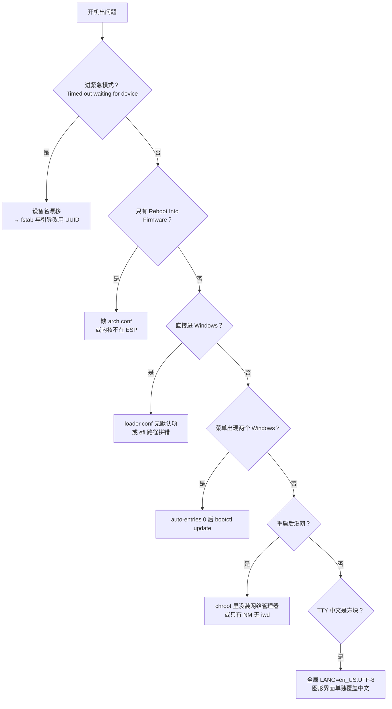

# Linux

> **人类入口页 / 学科 MOC**。本页由 agent 生成，正文你可自由改写。知识内容全部在 `wiki/`，此处只做导航与进度。

**当前覆盖**：一台机器装 Arch Linux 的完整实践——从分区到引导、从联网到中文环境，外加 12 个真实踩坑的解法。素材已全部编译（2/2）。

## 知识地图

## 安装流水线（时间顺序）

## 排错决策树

## 页面清单

| 页面 | 类型 | 成熟度 | 一句话 |
|---|---|---|---|
| [[磁盘分区与挂载]] | concept | budding | 分区方案、格式化、挂载、fstab、Swap |
| [[UEFI双系统引导]] | concept | budding | 两方案 + 四个高频坑 |
| [[持久化块设备命名]] | concept | budding | 设备名会漂移，一律用 UUID |
| [[Linux中文显示与locale]] | concept | budding | TTY 锁英文、图形覆盖中文 |
| [[pacman故障排查]] | concept | budding | 签名/密钥环/换源三类故障集中处理 |
| [[Arch Linux]] | entity | budding | 发行版本体 |
| [[pacman]] | entity | budding | 包管理器与两个配置文件 |
| [[systemd-boot]] | entity | budding | 轻量 UEFI 引导器 |
| [[GRUB]] | entity | budding | 通用引导器，可探测 Windows |
| [[iwd]] | entity | budding | 无线守护进程 |
| [[fcitx5]] | entity | budding | 输入法框架 |
| [[NJUPT_Fastlogin]] | entity | seedling | 校园网自动登录脚本 |
| [[GRUB与systemd-boot]] | comparison | budding | 安装、配置、探测与已知故障 |
| 2 篇摘要 | summary | budding | 见 [[_Index_Wiki]] |

## 三条铁律

1. **fstab 和引导配置里只写 UUID**，永不写 `/dev/nvme0n1pX`。设备名在多次启动间会互换，这是紧急模式的头号成因。
2. **网络管理器必须在 `chroot` 内装好并 enable**，出了 chroot 再补就得再进一次 Live。
3. **已有 EFI 分区不要重新格式化**，否则会连带毁掉 Windows 的引导。

## 安全提醒

> 配置仓库时**绝不要**用 `SigLevel = never` 跳过签名验证。有人这样「图省事」，代价是失去整条软件供应链的完整性校验。

## 状态与待办

- [x] 2 篇素材已编译为 wiki
- [x] 5 个概念页 + 7 个实体页 + 1 个对比页
- [x] 已裁定：素材中的 `/dev/mem0n1`、`/dev/mem1` 是笔误，应为 `nvme*`
- [x] 把 [[GRUB]] 与 [[systemd-boot]] 的取舍搬进 [[GRUB与systemd-boot]]
- [x] 补 [[pacman故障排查]]，集中 PGP 签名 / 密钥环 / 换源三类问题

## 原始素材

- [[raw/Linux/ArchLinux Installation Guide]]
- [[raw/Linux/Installation_Problems]]

返回 [[_Index_Wiki]]。
