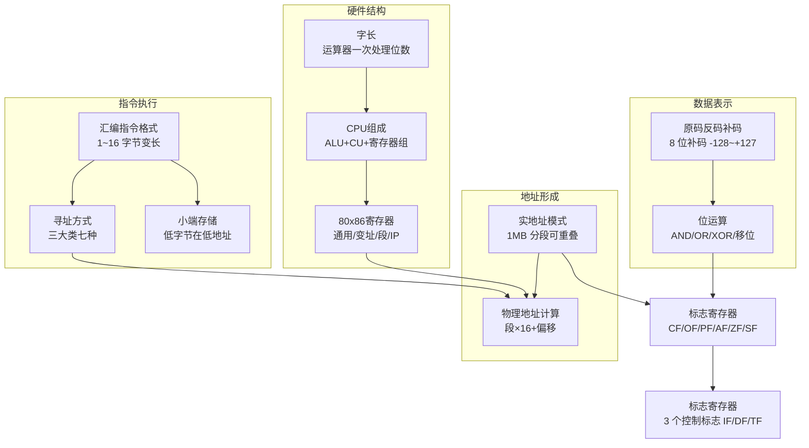
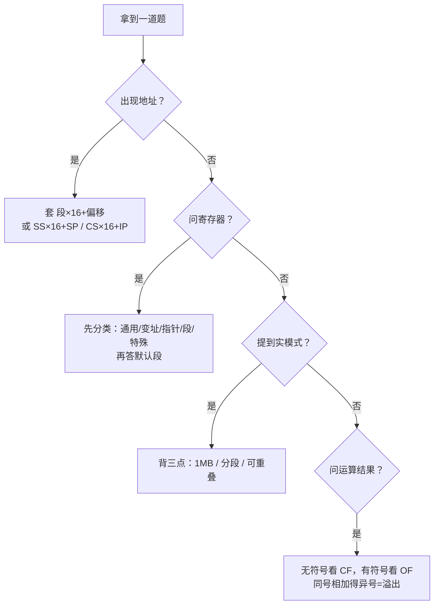

# Microcomputer_Principles

> **人类入口页 / 学科 MOC**。本页由 agent 生成，正文你可自由改写。知识内容全部在 `wiki/`，此处只做导航与进度。

**当前覆盖**：数据表示 → 硬件结构 → 地址形成 → 指令与寻址 → 状态标志，5 条主线共 4 篇素材已编译（4/4）。

## 知识地图

## 建议学习顺序

## 页面清单

| 页面 | 类型 | 成熟度 | 一句话 |
|---|---|---|---|
| [[原码反码补码]] | concept | budding | 三种机器数编码，补码统一加减法 |
| [[位运算]] | concept | budding | 逐位逻辑与移位，掩码/置位的基础 |
| [[字长]] | concept | budding | 运算器一次处理的最大位数 |
| [[CPU组成]] | concept | budding | 运算器 + 控制器 + 寄存器组 |
| [[80x86寄存器]] | concept | budding | 五类寄存器与默认段约定 |
| [[实地址模式]] | concept | budding | 1MB、分段、允许重叠、无保护 |
| [[物理地址计算]] | concept | budding | 段地址 × 16 + 偏移地址 |
| [[标志寄存器]] | concept | budding | 6 状态 + 3 控制标志 |
| [[寻址方式]] | concept | budding | 三大类七种，操作数在哪 |
| [[汇编指令格式]] | concept | budding | 标号: 操作码 操作数 ; 注释 |
| [[小端存储]] | concept | budding | 低字节放低地址 |
| [[80x86]] | entity | budding | 处理器家族，8086/386/486 |
| [[实模式与保护模式]] | comparison | budding | 四项对照 + 素材未覆盖项登记 |
| 4 篇摘要 | summary | budding | 见 [[_Index_Wiki]] |

## 解题套路（看完就能用）

## 高频易错点

| 易错点 | 正确说法 |
|---|---|
| IP 可以 MOV 改写 | ❌ 不可，只能 JMP/CALL/RET 间接改 |
| 一个逻辑段 1MB | ❌ 段最大 64KB，总空间 1MB |
| BX 是变址寄存器 | ❌ BX 是基址寄存器 |
| BP 默认段是 DS | ❌ BP 默认 SS |
| 标志寄存器每位都有含义 | ❌ 有保留位 |
| 实模式禁止段重叠 | ❌ 允许重叠与交叉 |

> 已裁定：`20A0H:0F6H` 的物理地址是 **20AF6H**，素材原文的 21B60H 是抄录串行。详见 [[物理地址计算]]。

## 状态与待办

- [x] 4 篇素材已编译为 wiki
- [x] 11 个概念页 + 1 个实体页 + 1 个对比页
- [x] 新建 [[实模式与保护模式]] 对照表
- [x] **例题事项已关闭（2026-10-27）**：你删除了《B、H的算术和逻辑运算》里残缺的逻辑运算例题，并要求不再追补。残留的「掩码 / 置位」两行结果唯一，已在 [[2026-10-14-二进制与十六进制算术及逻辑运算]] 按可确定值记录（`10101100 AND 11110000 = 10100000`；`10000011 OR 00001000 = 10001011`），不改原文。

## 原始素材

- [[raw/Microcomputer_Principles/原码、反码、补码]]
- [[raw/Microcomputer_Principles/B、H的算术和逻辑运算]]
- [[raw/Microcomputer_Principles/80x86微处理器]]
- [[raw/Microcomputer_Principles/汇编语言指令集（一）]]

## 跨学科综述

- [[寄存器时钟与分频]] —— 寄存器/标志/位运算与 FPGA 的 reg/wire/always 对照，含顺序 vs 并行、时钟显式化、复位三个差异

返回 [[_Index_Wiki]]。
