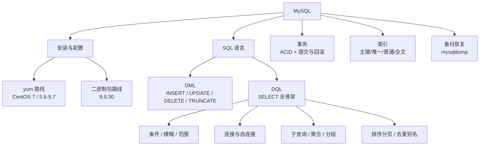

# MySQL

> **人类入口页 / 学科 MOC**。本页由 agent 生成，正文你可自由改写。知识内容全部在 `wiki/`，此处只做导航与进度。

**当前覆盖**：5 篇素材全部编译（5/5）——两条安装路线（yum 装 5.6/5.7、二进制包装 8.0.30）+ 数据管理（DML）+ 查询（DQL）+ 事务/索引/备份。产出 5 摘要 + 2 概念 + 2 实体。另有 3 页无 raw 素材的补课页（`provenance: external`）：[[事务隔离级别]]、[[B+树索引]]、[[binlog与增量恢复]]。

## 知识地图

## 建议学习顺序

## 页面清单

| 页面 | 类型 | 成熟度 | 一句话 |
|---|---|---|---|
| [[DQL查询]] | concept | budding | SELECT 子句链与执行顺序 |
| [[DML数据管理]] | concept | budding | 增删改四件套与 TRUNCATE 的区别 |
| [[事务隔离级别]] | concept | budding | 四种隔离级别与三种并发异常；无 raw 素材（external） |
| [[B+树索引]] | concept | budding | InnoDB 为何选 B+ 树；无 raw 素材（external） |
| [[binlog与增量恢复]] | concept | budding | redo/undo/binlog 三分工 + 时间点恢复流程；external |
| [[MySQL]] | entity | evergreen | 实体页 + 两条安装路线与版本冲突标注 |
| [[CentOS]] | entity | budding | EL7 的 yum/rpm 与 EOL 事实 |
| [[2026-10-27-MySQL8安装]] | summary | budding | 8.0.30 九步安装（二进制包） |
| [[2026-10-27-CentOS7安装MySQL]] | summary | budding | yum 装 5.6/5.7（并入 `CentOS-7-reg.repo`） |
| [[2026-10-27-MySQL数据管理]] | summary | budding | DML 与四种删表方式的对照 |
| [[2026-10-27-DQL查询]] | summary | budding | SELECT 全骨架 + 连接 + 子查询 |
| [[2026-10-27-MySQL事务索引与备份]] | summary | budding | ACID、四类索引、EXPLAIN、mysqldump |

## ✅ 两条安装路线按版本分家（2026-10-27 已裁定）

| 项目 | 5.6 / 5.7（yum 路线） | 8.0.30（二进制包路线） |
|---|---|---|
| 字符集 | `utf8` | `utf8mb4`（8.0 默认） |
| 授权 | `GRANT ... IDENTIFIED BY` 一步到位 | 该语法已移除，必须**先建用户再授权** |
| 服务管理 | `/etc/init.d/mysqld` + chkconfig | 建议 systemd unit（素材只给了 init.d） |
| 适用场景 | 仅 5.x 老环境 | [[Hive]] 元数据库要求 8.0，走这条 |

> 素材原文把两条路线当成通用步骤给出，**照抄必踩坑**。owner 已裁定「版本分家」：5.x 线只对 5.x 成立，8.0 线只对 8.0 成立，互不套用。[[2026-10-27-CentOS7安装MySQL]] 页首已加「仅适用 5.x」横幅；版本依据见 [[版本生命周期与EOL]]，判定归属见 [[MySQL]] 的 ✅ 段落。

## 高频易错点

| 易错点 | 正确说法 |
|---|---|
| `utf8` 就是 UTF-8 | MySQL 的 `utf8` 是 3 字节旧实现（8.0 已别名 `utf8mb3`），要真 UTF-8 用 `utf8mb4` |
| `character-set-server` 写在 `[mysql]` 段 | 它是服务端变量，必须写 `[mysqld]`，否则改完不生效 |
| `DELETE` 与 `TRUNCATE` 一样 | DELETE 可带条件、可回滚、逐行记日志；TRUNCATE 清空整表、重置自增、不可回滚 |
| 全文索引只能用于 MyISAM | MySQL 5.6.4 起 InnoDB 也支持 `FULLTEXT` |
| EXPLAIN 的 `eq_reg` / `indexhe` | 应为 `eq_ref` / `index`（素材拼写错误） |
| 事务一定「要么全成功」 | 只有**显式提交**才落盘；autocommit 下每条语句自成一个事务 |

## 原始素材

- [[raw/Frontend_Backend/MySQL8]]
- [[raw/Frontend_Backend/Centos7_Install_MySQL]]
- [[raw/Frontend_Backend/CentOS-7-reg.repo]]
- [[raw/Frontend_Backend/MySQL_Data_Management]]
- [[raw/Frontend_Backend/DQL_Command]]
- [[raw/Frontend_Backend/MySQL_Operations]]

## 状态与待办

- [x] 5 篇素材已编译为 wiki（5 摘要 + 2 概念 + 2 实体）
- [x] 5 处素材事实订正写入页面（`eq_ref`/`index`、InnoDB 全文索引、`right join` 等）
- [x] **已裁定（2026-10-27）**：为 [[2026-10-27-CentOS7安装MySQL]] 加「仅适用 5.x」页级横幅，两条线互不套用
- [x] **2026-10-27 已补三页**（无 raw 素材，按 AGENTS.md §4.3 标 `provenance: external`、状态上限 `budding`）：[[事务隔离级别]]、[[B+树索引]]、[[binlog与增量恢复]]。三页共 9 处标「待核」，最需补源的是 InnoDB FULLTEXT 起始版本 5.6.4、8.0 的 binlog_format 默认值、`--idempotent` 默认值
- [ ] 素材里例题用到的 `student`/`subject`/`result`/`grade` 四张表没有建表语句，想复现查询需另补

## 跨学科综述

- [[从裸机到Hive-Metastore]] —— MySQL 8.0 是 Hive Metastore 的元数据库，本页是那条链的第三层
- [[版本生命周期与EOL]] —— 5.6/5.7/8.0 三条线的支持状态

返回 [[_Index_Wiki]]。
