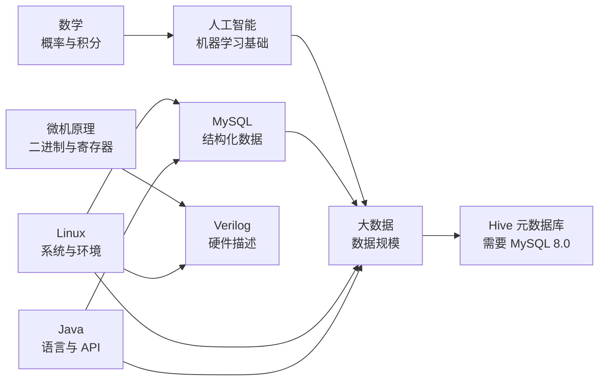

# 知识库总览

> **人类入口页**。本页由 agent 生成，正文你可自由改写。八个学科 MOC 从这里进；明细条文在 `wiki/`，原始素材在 `raw/`（只读）。

## 全库快照（2026-10-27）

| 项目 | 数值 |
|---|---|
| 学科数 | 8 |
| raw 素材 | 37 篇知识素材（+1 个前端库 `axios.min.js` 排除） |
| wiki 内容页 | 127（摘要 36 / 概念 64 / 实体 19 / 对比 5 / 综合 3），另 1 页总索引 |
| 外部来源页 | 12 个概念页无 raw 素材（`provenance: external`，status 上限 budding） |
| 未编译素材 | **0** |
| 已裁定素材错误 | 28 条 |
| 未裁决冲突 | **0 条**（2026-10-27 两条已由你裁定）+ 14 条素材内部不一致 |
| 待补素材 | 5 个学科有明确缺口，见各 MOC 的「待办」 |

## 八个入口

| 学科 | MOC | 素材 | 一句话定位 |
|---|---|---|---|
| 数学 | [[College_Math]] | 3 | 一条从高斯积分到边缘密度的推导链 |
| 微机原理 | [[Microcomputer_Principles]] | 4 | 数据表示 → 硬件 → 地址 → 指令 → 标志 |
| Linux | [[Linux]] | 2 | 装 Arch 的完整实践 + 12 个踩坑 |
| 人工智能 | [[Artificial_Intelligence]] | 9 | 一门课的八章 + 一门库课 |
| Java | [[Java]] | 9 | SE 入门：语法 → OOP → 常用 API |
| MySQL | [[MySQL]] | 5 | 两条安装路线 + SQL + 事务索引备份 |
| 大数据生态 | [[大数据生态]] | 3 | Hadoop/Hive/Zeppelin 装机线 |
| 嵌入式(FPGA) | [[Embedded_System]] | 1 | Verilog 点灯到板上有反应 |

## 学科之间的关系

实际存在的交叉只有三种，其余是「共享环境」而非知识交叉：

1. **数学 → 人工智能**：[[机器学习]] 的损失函数、[[二维正态分布]] 的协方差，是同一套概率语言。
2. **MySQL 8.0 → 大数据**：[[Hive]] 的元数据库强依赖 8.0，所以 [[2026-10-27-MySQL8安装]] 是它的前置。
3. **Linux → 所有装机线**：MySQL、Hadoop、Hive、Zeppelin 全部装在 CentOS 7 上，但 [[Linux]] 那条线是 Arch——两者是**同一件事的两条相反路线**（滚动 vs 稳定），不要混着照抄。

## 已裁定与仍需你定

**2026-10-27 已由你裁定**：

1. MySQL 5.x 与 8.0 两条安装线按版本分家，字符集与授权语法不得互抄 → [[MySQL]]、[[版本生命周期与EOL]]
2. 图灵测试 30% 是图灵 1950 年论文的预测性阈值，不是共识判据 → [[图灵测试]]
3. `areas/` 里 6 张手写 MOC 交由 agent 维护，已同步进 `AGENTS.md` §2 / §6
4. README 与 README.zh.md 删掉已失效的 `_Index_All.md`，补齐 8 学科

**仍需你定**：

| # | 事项 | 位置 |
|---|---|---|
| 1 | **是否补素材**：Java 差继承/多态/异常/GC；MySQL 差隔离级别/B+ 树/binlog；大数据差真分布式；AI 差 CNN 细节；FPGA 差状态机与时序约束 | 各 MOC 的「待办」 |
| 2 | **外部来源页要不要留**：本库新增一批无 raw 素材、按 AGENTS.md §4.3 标 `provenance: external` 的页，状态上限 `budding`。是保留这类补课页，还是等有 raw 素材再收编 | [[_Index_Wiki]] §五 |
| 3 | **数学与 AI 之间的结构空洞**：线性代数、多元微积分全库无素材，见 [[概率与机器学习之间的一段路]] 的缺口清单 | synthesis |

## 建议阅读路线

- **只想复习考试**：[[College_Math]] → [[Microcomputer_Principles]]（这两科是原库的骨架）
- **想搭环境**：[[Linux]] → [[MySQL]] → [[大数据生态]] → [[Artificial_Intelligence]] 的库课摘要
- **想学编程**：[[Java]] → [[MySQL]]（语言 + 存储，前后端最小闭环）
- **想学硬件**：[[Microcomputer_Principles]] → [[Embedded_System]]

## 维护约定

- `raw/` 永不改动；素材有错时在 wiki 页里记「原文错值 → 正确值 → 证据」，状态标「已裁定」，痕迹不删（AGENTS.md §4.2）。
- 本页与八个 MOC 只做导航与进度，知识内容一律不写在这里。
- 新建素材后，先到 [[_Index_Wiki]] 的 6.2 台账追加一行，再回本页更新快照。

返回 [[_Index_Wiki]]。
