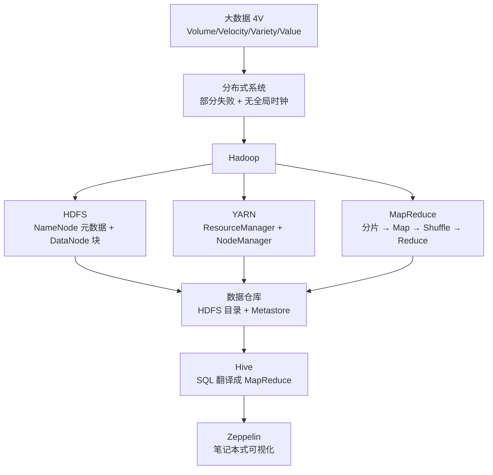
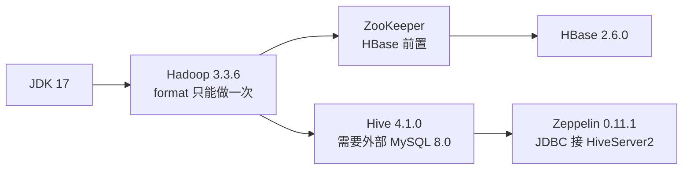

# 大数据生态

> **人类入口页 / 学科 MOC**。本页由 agent 生成，正文你可自由改写。知识内容全部在 `wiki/`，此处只做导航与进度。

**当前覆盖**：3 篇素材全部编译（3/3）——Hadoop 伪分布式安装、Hive 安装、Zeppelin 安装，产出 3 摘要 + 6 概念 + 3 实体。这是一条**装机线**，讲清了三件套为什么必须按顺序装、以及每一步的坑。另有 2 页无 raw 素材的补课页（`provenance: external`）：[[Hadoop集群模式]]、[[Hive分区与分桶]]。

## 知识地图

## 组件依赖顺序（不按这个顺序装必失败）

## 页面清单

| 页面 | 类型 | 成熟度 | 一句话 |
|---|---|---|---|
| [[大数据4V]] | concept | budding | 四条判据，及为何必然导向分布式 |
| [[分布式系统]] | concept | budding | 部分失败、无全局时钟、数据分散 |
| [[HDFS]] | concept | budding | 元数据与数据块分离，副本抗失败 |
| [[MapReduce]] | concept | budding | 分片→Map→Partition/Sort/Group→Reduce |
| [[YARN]] | concept | budding | 资源调度层与 shuffle 的 aux-services |
| [[数据仓库]] | concept | budding | schema on read：HDFS 目录 + 元数据 = 表 |
| [[Hadoop集群模式]] | concept | budding | 单机 / 伪分布 / 完全分布的分界与用途；无 raw 素材（external） |
| [[Hive分区与分桶]] | concept | budding | 分区是目录、分桶是文件；external |
| [[Hadoop]] | entity | budding | 四模块与两种运行模式 |
| [[Hive]] | entity | budding | 三进程、启动顺序、两大坑 |
| [[Apache Zeppelin]] | entity | budding | Interpreter 机制与 JDBC 接 Hive |
| [[2026-10-27-大数据安装]] | summary | budding | 伪分布式全流程 + 6 条勘误 |
| [[2026-10-27-Hive]] | summary | budding | 九步安装 + 三个典型故障 |
| [[2026-10-27-Apache Zeppelin]] | summary | budding | 安装 + 两处 Hadoop 补丁 + JDBC |

## 四个不可逆操作（做错只能重装）

1. **`hdfs namenode -format` 只能执行一次**。重复格式化会生成新 clusterID，老 DataNode 注册不上，且清空 tmp 目录等于丢数据。
2. **`dfs.replication` 在伪分布式下必须是 1**，否则块永远缺副本、一直报 under-replicated。
3. **Hive 的 `schematool -initSchema` 只在首次初始化时跑**，重复跑会与已有 Metastore 冲突。
4. **Zeppelin 的 `HADOOP_MAPRED_HOME` 必须指向 Hadoop 根目录**，缺它 Spark/Hive 解释器全部起不来。

## 高频易错点

| 易错点 | 正确说法 |
|---|---|
| HBase 解压目录带 `-bin` | 目录是 `hbase-2.6.0`，`-bin` 只是包名后缀 |
| `hive.server2.active.passive.ha.enable` 是「跳过检查」 | 它是启用 HiveServer2 主备 HA |
| `zeppelin-daemon.sh start` 是前台启动 | 它是后台守护；前台用 `bin/zeppelin.sh` |
| Hadoop/Hive/Zeppelin 版本可以随便配 | 4.1.0 官方配套 Hadoop 3.4.1；配 3.3.6 的是 4.0.1 |
| 整条栈装完就能用于生产 | 素材给的是**伪分布式**；且踩在 EOL 版本上（CentOS 7 已于 2024-06-30 EOL） |

## 与 MySQL 线的交叉

Hive 4.1.0 的元数据库必须有 MySQL 8.0 支持——这正是 [[2026-10-27-MySQL8安装]]（二进制包装 8.0.30）存在的原因；yum 路线的 5.6/5.7 满足不了。两页已互链。

## 状态与待办

- [x] 3 篇素材已编译为 wiki（3 摘要 + 6 概念 + 3 实体）
- [x] 11 处素材事实订正写入页面，4 处未裁决冲突标 ⚠️ 未擅自定性
- [ ] **待你决定**：是否补「HDFS 配额」「YARN 队列与 HA」「Spark / Flink」——多节点模式与 Hive 建模已于 2026-10-27 补页（[[Hadoop集群模式]]、[[Hive分区与分桶]]）
- [x] **已完成（2026-10-27）**：EOL 版本清单独立成页 [[版本生命周期与EOL]]，并与 [[从裸机到Hive-Metastore]] 串成依赖链

## 跨学科综述

- [[从裸机到Hive-Metastore]] —— 五个组件的版本配套矩阵、三个真实卡点、按层排查顺序

返回 [[_Index_Wiki]]。
